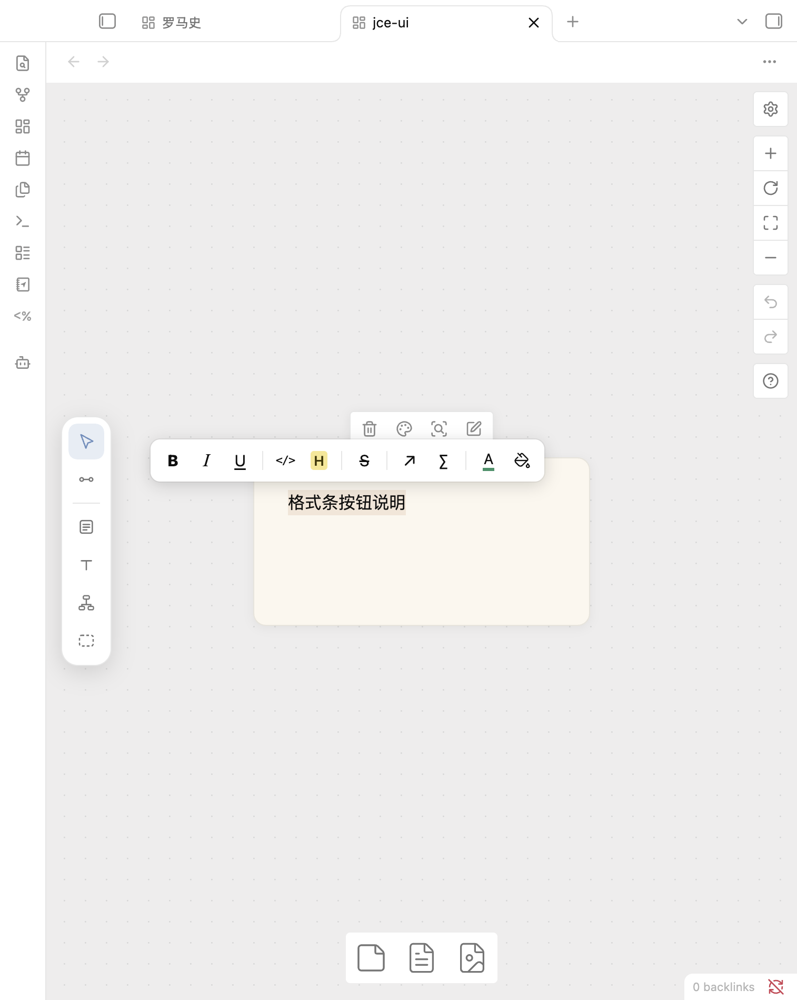
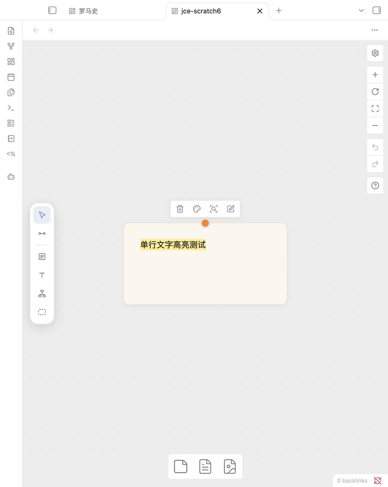
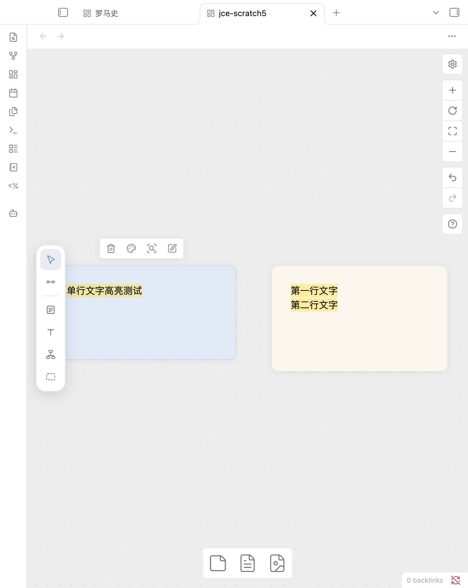
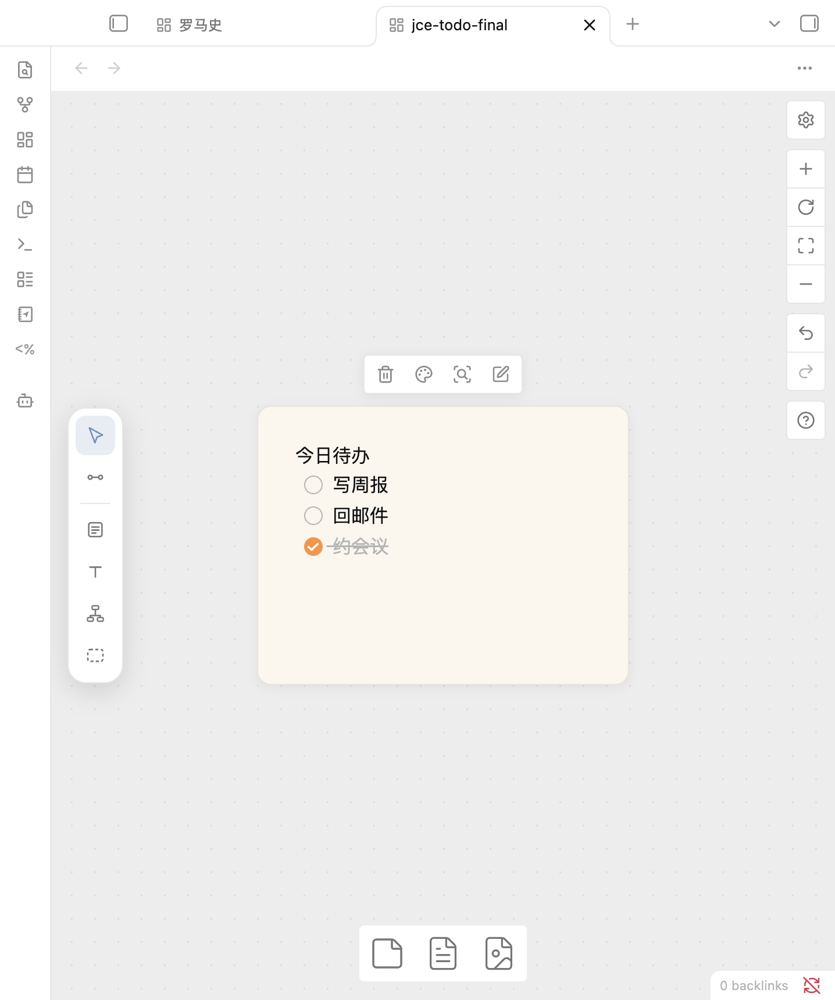
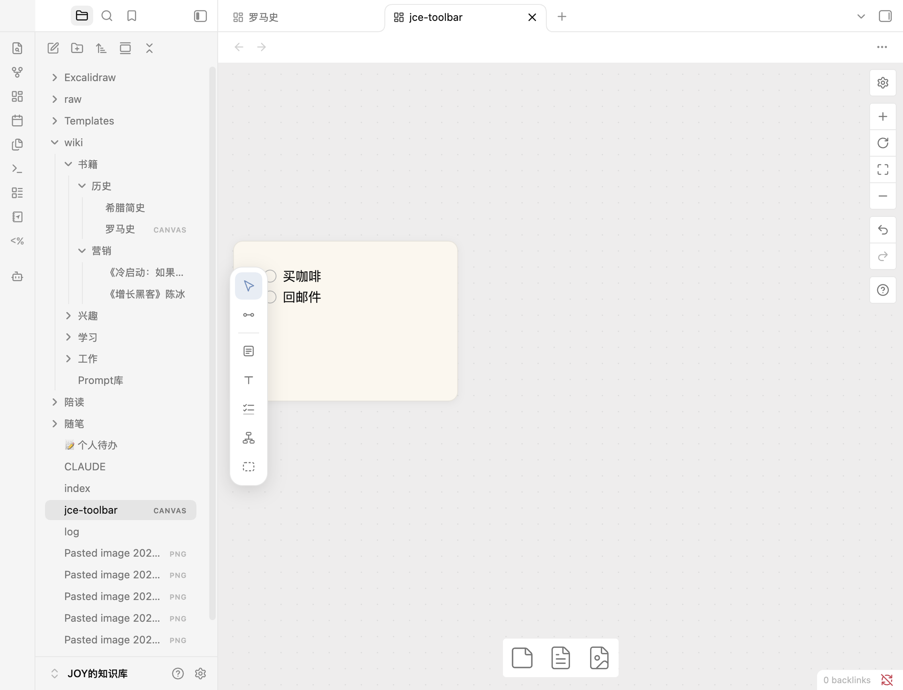

# Canvas 增强（Obsidian 插件）

在 Obsidian **原生 Canvas** 上补 Heptabase 风格的输入与结构整理：笔记卡、Text、思维导图、分区，
外加真实连线、空白新建菜单、对象右键菜单和文字选区格式条。

- 插件 id：`canvas-enhance`，版本 `1.1.0`
- 安装：插件目录 `~/canvas-enhance`（vault 里是符号链接），重启 Obsidian 或在「第三方插件」里重载即可
- 构建：`npm run build`（产物 `main.js` + `styles.css`）　类型检查：`npm run check`

## 用法

| 操作 | 方式 |
|---|---|
| 选择 / 连线 / 笔记卡 / Text / 待办 / 思维导图 / 分区 | 工具栏，或 `V` `C` `N` `T` `D` `M` `G` |
| 新建分区（居中） | `⌘G` |
| 新建导图子节点 | 选中导图节点后 `Tab`；在节点内编辑时按 `Tab` 同样生效 |
| 空白处新建 | 画布空白处右键 → 四项菜单 |
| 对象菜单 | 右键对象 → 颜色 / 卡片底色（笔记卡）/ 移除（导图另有 折叠 / 展开 / 旋转） |
| 卡片底色 | 右键笔记卡 → 卡片底色，9 种柔和色 + 默认；写入画布文件，重开保留 |
| 连线 | 选中连线工具后依次点起点、终点；`Esc` 退出 |
| 文字格式条 | 在卡片/Text/导图里划选文字，自动出现在选区上方；再点同一按钮取消 |
| 文字背景色 | 格式条最右侧的油漆桶：给选中文字铺色（黄/绿/蓝/粉/灰），与 H（黄色高亮）不同 |
| 待办 | 工具栏「待办」按钮或 `D` 新建待办卡；卡片里直接点复选框勾选；行首 `[]` + 空格自动变待办项 |

## 外观

| 格式条 | 高亮即时生效 | 卡片底色 |
|---|---|---|
|  |  |  |
| |  | |
|  | | |

## 已确认的设计决定

- 高亮（H）和文字底色（油漆桶）是两个独立功能，不合并：H 用 Obsidian 原生 `==`（黄色，可被搜索/导出识别），底色用内联背景色。
- 底色按钮图标最终保留油漆桶（2026-11-19 对比过色块 A、T+色条、半填方块、纯色块、角标 A 五个方案）。
- 图标对比页：`docs/icon-options.html`。

## 设计要点

- **类型存在画布文件里**：每个节点写入 `jce` / `jceRoot` / `jceLayout` / `jceFold`，
  依赖 Obsidian 的 `unknownData` 原样回写，不另建卡片库，也不会有 `data.json` 与文件不同步的问题。
- **父子关系就是原生边**：层级用真实 canvas 边存储，重开/换设备都还在。
- **层级线画在画布世界层**：单个 SVG 挂在带 `translate/scale` 的 `.canvas` 层里，平移缩放天然跟随，不逐帧算坐标。
- **先接箭头再进编辑**：结构改完才开会话，避免「新建后箭头消失」。
- **透明用 CSS 变量而不是逐个选择器打压**：编辑态 iframe 每次重建都重新注入，白块问题从根上解决。
- **格式条是所见即所得**：应用格式后光标落到标记外，画布卡片里再隐藏 `==` 标记，
  不会先看到源码；多行选区按行分别套格式。
- **卡片底色写进画布文件**：`jceBg` 和其它类型字段一样存在节点上，重开、换设备都保留。
- **子树拖动靠预选**：按下时选中整棵子树，交给 Obsidian 自己的拖拽，位移/连线/层级都不打架。

## 已知问题

见 [COVERAGE.md](./COVERAGE.md) 第 4 节：第 2、3 个 Tab 子节点不自动进入编辑（双击可输入）；
macOS 默认原生菜单不进 DOM；长文本溢出等属 PRD 待定项。

补充：

- 卡片底色只对插件新建的笔记卡开放，画布里原有的原生卡片仍走 Obsidian 自己的颜色。
- 待办目前只支持画布里的文字卡（note / text）；链接到某个笔记文件的卡片不处理，勾选仍交给 Obsidian。
- 待办没有截止日期、没有跨卡片汇总面板，也不隐藏已完成项——这版只做「卡片内勾选」。
- 文字色 / 文字背景色用内联 `` 存进画布文本，Obsidian 会即时渲染；
  导出成纯 Markdown 时会保留这段 HTML。

## 目录

| 文件 | 作用 |
|---|---|
| `src/bridge.ts` | 唯一直接接触 Canvas 私有内部的地方（都已对 1.15.0 实测） |
| `src/model.ts` | 对象类型与导图结构（从原生边反推） |
| `src/layout.ts` | 纯几何：子节点尺寸/位置、层级线路径（可在 Node 里单测） |
| `src/overlay.ts` | 世界层 SVG 层级线 |
| `src/chrome.ts` | 类名同步、iframe 透明、原生 chrome 隐藏 |
| `src/mindmap.ts` | Tab 建子节点、子树拖动、折叠、旋转 |
| `src/format.ts` | 文字选区格式条 |
| `src/main.ts` | 插件装配、工具栏、快捷键、对象动作 |
| `tests/` | CDP 真实交互自测（`node tests/e2e.mjs`） |
| `.legacy/` | 0.2.0 旧实现备份 |
